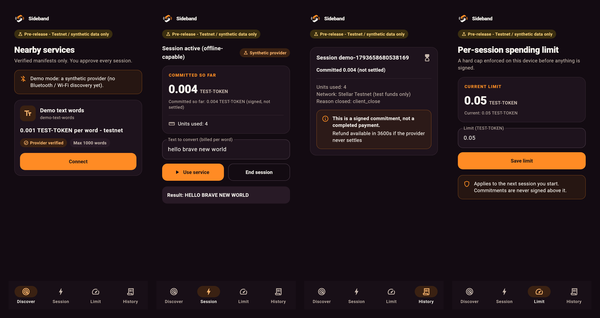
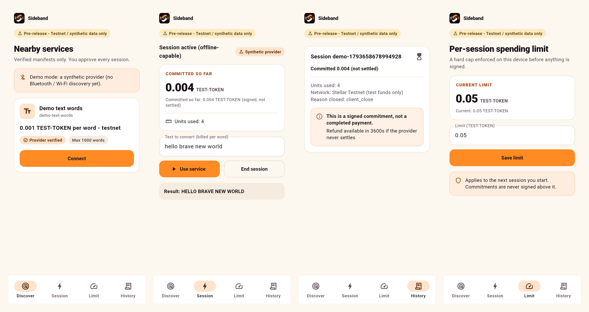
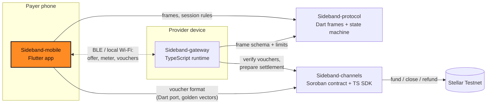

<div align="center">


# Sideband Mobile

**The Sideband payer app: discover nearby services, cap your spend, sign vouchers.**

Part of [Sideband](#how-sideband-works): nearby services, metered value, Stellar settlement.

[](https://github.com/Sideband34/Sideband-mobile/actions/workflows/ci.yml)
[](./LICENSE)
[](#status)
[](./SECURITY.md)
[](https://github.com/Sideband34/Sideband-gateway/blob/main/gitbook/README.md)
[](https://github.com/Sideband34/Sideband-mobile/issues?q=is%3Aissue+is%3Aopen+label%3A%22Stellar+Wave%22)

[Docs](https://github.com/Sideband34/Sideband-gateway/blob/main/gitbook/README.md) · [Live site](https://sideband-web1.vercel.app) · [Quick start](#quick-start) · [Status](#status) · [Architecture](#how-it-fits-together) · [Contributing](#contributing) · [Security](#security)

</div>

> [!WARNING]
> Pre-release software for **Stellar Testnet and synthetic assets only**. The channel contract and
> voucher format are **unaudited**. Do not use with real funds.

## What this is

Sideband-mobile is the payer's app. It finds a nearby provider, checks the provider's signed manifest, enforces a spending cap you choose, signs payment vouchers with a key that stays on the phone, and keeps honest receipts that never call a payment settled before Stellar confirms it.

What is inside:

- **Domain** (`lib/domain`): `sideband-commit-v2` voucher signing (the upstream one-way-channel
  commitment XDR, hand-encoded; Dart signatures equal the TypeScript golden vectors), strkey codec,
  manifest verification (stale, network, tamper), `PayerSession` (spend cap = min(user limit,
  offer cap, deposit), monotonic signing, pay-on-402) and receipts that never claim settlement
  early.
- **Integrations** (`lib/integrations`): provider link and discovery interfaces, a synthetic
  `LoopbackProvider` mirroring gateway rules, `HttpProviderLink` for the real gateway, a
  `SessionRunner`, and a `SecureStore` abstraction with a durable signed ledger and history.
- **App** (`lib/app`, `lib/features`, `lib/design_system`): Riverpod + go_router shell with
  Discover, Session, Limit, History and Receipt screens, light and dark brand themes, and a
  persistent pre-release banner.
- **Cross-repo e2e** (`test/e2e`): spawns the real TypeScript gateway and runs the Dart payer
  against it over HTTP (skips automatically when sibling checkouts are absent).

## Screenshots

Widget-test renders of the app on the synthetic demo provider (not device captures; regenerate
with `SIDEBAND_SCREENSHOTS=1 flutter test test/screenshots_test.dart`):



<details>
<summary>Light theme</summary>



</details>

## Quick start

Requires Flutter (stable) with Dart 3.5+.

```bash
git clone https://github.com/Sideband34/Sideband-mobile && cd Sideband-mobile
flutter pub get
dart format --output=none --set-exit-if-changed lib test
flutter analyze
flutter test                      # 56 tests; e2e skips without sibling checkouts
flutter run                       # on an emulator or device (not yet verified here)
```

To run the cross-repo e2e test, check out and install
[Sideband-gateway](https://github.com/Sideband34/Sideband-gateway) and build
[Sideband-channels](https://github.com/Sideband34/Sideband-channels) next to this repo (or set `SIDEBAND_GATEWAY_DIR`).

## Download

There is **no App Store or Google Play listing**. Pushing a `v*` tag runs
[`release.yml`](./.github/workflows/release.yml), which tests the app, builds a release APK and
publishes it as the **latest** (non-prerelease) GitHub Release with a fixed asset name,
`sideband-android.apk`, plus `sideband-android.apk.sha256`. So this link always serves the newest
build once a tag exists:

```
https://github.com/Sideband34/Sideband-mobile/releases/latest/download/sideband-android.apk
```

No tag has been published yet, so that link returns 404 until the first `v*` tag. All builds:
[Releases page](https://github.com/Sideband34/Sideband-mobile/releases).

Release signing is optional. Set these repository secrets to sign with your upload key; without
them the APK is signed with the debug key (the release notes say which):

| Secret | Value |
|---|---|
| `ANDROID_KEYSTORE_BASE64` | `base64 -w0 upload.jks` |
| `ANDROID_KEYSTORE_PASSWORD` | keystore password |
| `ANDROID_KEY_ALIAS` | key alias |
| `ANDROID_KEY_PASSWORD` | key password |

Launcher icons are generated from the approved brand mark with `dart run flutter_launcher_icons`
(config in `pubspec.yaml`).

## Status

| Area | Status |
|---|---|
| Voucher signing (matches TS golden vectors), manifest checks, spend caps | Implemented, tested |
| Session runner, synthetic loopback provider, HTTP provider link | Implemented, tested |
| Several sessions per channel (v2 baseline), baseline-gap detection | Implemented, tested |
| Payer crash resume (session journal, re-send of an undelivered voucher) | Implemented, tested |
| Keychain / keystore `SecureStore` and device-key signer | Implemented on `flutter_secure_storage`; tested via platform-channel mocks; not verified on a device |
| Durable history (atomic file store) | Implemented, tested |
| Channel tab: status, top-up, close-start, refund | Defaults to a labelled **simulation** (no transaction sent). A real Soroban client (`SorobanChannelClient`, `stellar_flutter_sdk` 3.10.0) is implemented and unit-tested; one real Testnet `top_up` ran through it. **Not selected by the UI yet; never run on a phone** |
| Release APK | `flutter build apk --release` succeeds on the owner's Windows machine (needs `kotlin.incremental=false` and `compileSdk` 36 for plugins, both set). **Not installed on any device** |
| App shell and screens, brand theme | Implemented, widget-tested |
| e2e against the real gateway | Implemented; skipped in CI (needs sibling checkouts) |
| BLE (`universal_ble`) and LAN WebSocket transports | Adapters unit-tested with fakes; **untested on hardware**, not wired into discovery |
| On-chain channel actions and settlement observation | **Not implemented**: receipts stay "committed" |
| Android / iOS builds on a device | **Not verified**; release workflow (fixed `sideband-android.apk`, latest release) not yet run |
| Store listings | None |

### Compatibility

| Repository | Contract |
|---|---|
| [Sideband-protocol](https://github.com/Sideband34/Sideband-protocol) v0.2.0 | frames (v2 baseline), `SessionMachine`, `Amount` (git dependency on `main`) |
| [Sideband-channels](https://github.com/Sideband34/Sideband-channels) v0.1.0 | voucher bytes (`sideband-commit-v2` golden vectors in `test/fixtures/`) |
| [Sideband-gateway](https://github.com/Sideband34/Sideband-gateway) v0.1.0 | manifest + frame transcript fixture, HTTP API for e2e |

## How Sideband works

Sideband lets a phone pay a nearby device for a small metered service (for example, text
processing priced per word) over Bluetooth LE or local Wi-Fi, without needing the internet during
the session:

1. **Fund a channel (online).** The payer deposits a Testnet asset into a Soroban payment channel
   bound to one provider.
2. **Discover nearby.** Devices find each other locally, verify the provider's signed service
   manifest, and agree on price, units and a spending cap.
3. **Stream with signed vouchers (offline).** Each metered unit is paid with a cumulative,
   domain-separated voucher signed on the phone. The provider verifies it locally and rejects
   replays and rollbacks.
4. **Settle later (online).** The provider submits its highest voucher on-chain; the rest of the
   deposit is refundable to the payer after expiry.

A voucher is a commitment against already-locked funds, **not** a completed payment. Nothing is
shown as settled until Stellar confirms it.

## How it fits together

Four repositories, one responsibility each. No payment signing lives in transport code, and no
chain logic lives in the app. This repository is highlighted.



| Repository | Stack | Responsibility |
|---|---|---|
| [**Sideband-mobile**](https://github.com/Sideband34/Sideband-mobile) | Flutter | Payer app: discovery UX, spend limits, voucher signing, history and receipts |
| [Sideband-protocol](https://github.com/Sideband34/Sideband-protocol) | Dart | Versioned session frames, canonical encoding, session state machine, metering, transport contract |
| [Sideband-gateway](https://github.com/Sideband34/Sideband-gateway) | TypeScript | Provider runtime: signed manifest, metered service, anti-replay voucher validation, settlement prep, landing site |
| [Sideband-channels](https://github.com/Sideband34/Sideband-channels) | Rust · TypeScript | Soroban payment channel contract, cumulative voucher format, channel adapters, settlement intents |

Cross-repo contracts are pinned with fixtures: voucher golden vectors from `Sideband-channels`,
and a synthetic session transcript from `Sideband-gateway`. See
[`docs/ARCHITECTURE.md`](./docs/ARCHITECTURE.md) for data and ownership paths.

## Tech stack

| Layer | Technology |
|---|---|
| App | Flutter (stable), Dart 3.5 or newer, Riverpod 3, go_router 18 |
| Chain | `stellar_flutter_sdk` 3.10.0, `cryptography` for ed25519 |
| Storage | `flutter_secure_storage` 11 (Keychain and Keystore), an atomic file store for history |
| Transports | `universal_ble` 3.1.2 (experimental) and a local-network WebSocket link |
| Protocol | Sideband-protocol (git dependency) |
| Tests | `flutter test` (widget, unit and a cross-repo end-to-end test) |

## Project structure

```
lib/domain/          voucher signing, manifest checks, PayerSession, receipts
lib/integrations/    provider links, session runner, secure store
lib/transport/       BLE and local-network transports (experimental)
lib/app, lib/features, lib/design_system/   app shell, screens, themes
test/                unit, widget and end-to-end tests, golden vectors
android/, ios/       platform projects
```

## Contributing

Contributions are welcome. Start with [CONTRIBUTING.md](./CONTRIBUTING.md) for the local checks and the workflow, then pick an open issue labelled
[`Stellar Wave`](https://github.com/Sideband34/Sideband-mobile/issues?q=is%3Aissue+is%3Aopen+label%3A%22Stellar+Wave%22). Each issue lists context, scope, implementation notes and
acceptance criteria, and carries a `trivial`, `medium` or `high` complexity label. New here? Try [`good first issue`](https://github.com/Sideband34/Sideband-mobile/issues?q=is%3Aissue+is%3Aopen+label%3A%22good+first+issue%22).
Please follow the [Code of Conduct](./CODE_OF_CONDUCT.md).

**Drips Wave.** Sideband applies to [Drips Wave](https://docs.drips.network/wave) on Stellar. Acceptance and rewards depend on the organizers and are not guaranteed.

## Security

Report vulnerabilities privately, as described in [SECURITY.md](./SECURITY.md). The threat model and what is not covered are in [docs/SECURITY.md](./docs/SECURITY.md).
This is a Testnet prototype and has not been audited. Never post keys or seeds in an issue, even Testnet ones.

## Community

Questions and ideas: [GitHub Discussions](https://github.com/Sideband34/Sideband-mobile/discussions).
<!-- Owner: add the community invite link (Telegram or Discord) on this line when it exists. -->

## Maintainers

| Maintainer | Role | Contact |
|---|---|---|
| [Cjay-Cyber-2](https://github.com/Cjay-Cyber-2) | Maintainer | GitHub [issues](https://github.com/Sideband34/Sideband-mobile/issues) and [Discussions](https://github.com/Sideband34/Sideband-mobile/discussions) |

## Contributors

<a href="https://github.com/Sideband34/Sideband-mobile/graphs/contributors">
  
</a>

## License

[MIT](./LICENSE)
