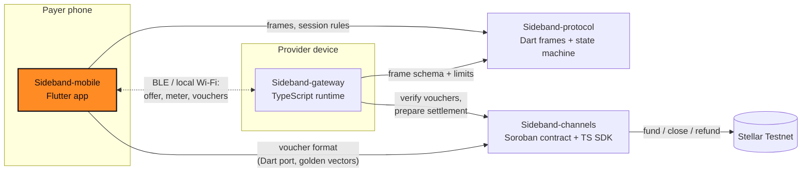

<div align="center">


# Sideband Mobile

**The Sideband payer app: discover nearby services, cap your spend, sign vouchers.**

Part of [Sideband](#how-sideband-works): nearby services, metered value, Stellar settlement.

[](https://github.com/Sideband34/Sideband-mobile/actions/workflows/ci.yml)
[](./LICENSE)
[](#status)
[](./SECURITY.md)

[How it works](#how-sideband-works) · [Quickstart](#quickstart) · [Status](#status) · [Architecture](#architecture) · [Contributing](#contributing) · [Security](#security)

</div>

> [!WARNING]
> Pre-release software for **Stellar Testnet and synthetic assets only**. The channel contract and
> voucher format are **unaudited**. Do not use with real funds.

## What this repository is

The Flutter app a **payer** uses. It discovers a provider, checks its signed manifest, enforces a
spending cap, signs cumulative vouchers and keeps honest receipts.

- **Domain** (`lib/domain`): `sideband-commit-v2` voucher signing (the upstream one-way-channel
  commitment XDR, hand-encoded; Dart signatures equal the TypeScript golden vectors), strkey codec,
  manifest verification (stale, network, tamper), `PayerSession` (spend cap = min(user limit,
  offer cap, deposit), monotonic signing, pay-on-402) and receipts that never claim settlement
  early.
- **Integrations** (`lib/integrations`): provider link and discovery interfaces, a synthetic
  `LoopbackProvider` mirroring gateway rules, `HttpProviderLink` for the real gateway, a
  `SessionRunner`, and a `SecureStore` abstraction with a durable signed ledger and history.
- **App** (`lib/app`, `lib/features`, `lib/design_system`): Riverpod + go_router shell with
  Discover, Session, Limit, History and Receipt screens, light and dark brand themes, and a
  persistent pre-release banner.
- **Cross-repo e2e** (`test/e2e`): spawns the real TypeScript gateway and runs the Dart payer
  against it over HTTP (skips automatically when sibling checkouts are absent).

## Screenshots

Widget-test renders of the app on the synthetic demo provider (not device captures; regenerate
with `SIDEBAND_SCREENSHOTS=1 flutter test test/screenshots_test.dart`):


<details>
<summary>Light theme</summary>


</details>

## Quickstart

Requires Flutter (stable) with Dart 3.5+.

```bash
git clone https://github.com/Sideband34/Sideband-mobile && cd Sideband-mobile
flutter pub get
dart format --output=none --set-exit-if-changed lib test
flutter analyze
flutter test                      # 56 tests; e2e skips without sibling checkouts
flutter run                       # on an emulator or device (not yet verified here)
```

To run the cross-repo e2e test, check out and install
[Sideband-gateway](https://github.com/Sideband34/Sideband-gateway) and build
[Sideband-channels](https://github.com/Sideband34/Sideband-channels) next to this repo (or set `SIDEBAND_GATEWAY_DIR`).

## Download

There is **no App Store or Google Play listing**. Pushing a `v*` tag runs
[`release.yml`](./.github/workflows/release.yml), which tests the app, builds a release APK and
attaches it (with a SHA-256 checksum) to a GitHub pre-release on the
[Releases page](https://github.com/Sideband34/Sideband-mobile/releases). No tag has been published yet, so there is no
APK yet.

Release signing is optional. Set these repository secrets to sign with your upload key; without
them the APK is signed with the debug key and named `...-debug-signed.apk`:

| Secret | Value |
|---|---|
| `ANDROID_KEYSTORE_BASE64` | `base64 -w0 upload.jks` |
| `ANDROID_KEYSTORE_PASSWORD` | keystore password |
| `ANDROID_KEY_ALIAS` | key alias |
| `ANDROID_KEY_PASSWORD` | key password |

Launcher icons are generated from the approved brand mark with `dart run flutter_launcher_icons`
(config in `pubspec.yaml`).

## Status

| Area | Status |
|---|---|
| Voucher signing (matches TS golden vectors), manifest checks, spend caps | Implemented, tested |
| Session runner, synthetic loopback provider, HTTP provider link | Implemented, tested |
| App shell and screens, brand theme | Implemented, widget-tested |
| e2e against the real gateway | Implemented; skipped in CI (needs sibling checkouts) |
| BLE / local Wi-Fi discovery and transport | **Not implemented** |
| Keychain / keystore storage and signer | **Not implemented**: test-only `SeedSigner`, volatile in-memory store |
| Channel funding and on-chain settlement observation | **Not implemented**: receipts stay "committed" |
| Android / iOS builds on a device | **Not verified**; release workflow not yet run |
| Store listings | None |

### Compatibility

| Repository | Contract |
|---|---|
| [Sideband-protocol](https://github.com/Sideband34/Sideband-protocol) v0.1.0 | frames, `SessionMachine`, `Amount` (git dependency on `main`) |
| [Sideband-channels](https://github.com/Sideband34/Sideband-channels) v0.1.0 | voucher bytes (`sideband-commit-v2` golden vectors in `test/fixtures/`) |
| [Sideband-gateway](https://github.com/Sideband34/Sideband-gateway) v0.1.0 | manifest + frame transcript fixture, HTTP API for e2e |

## How Sideband works

Sideband lets a phone pay a nearby device for a small metered service (for example, text
processing priced per word) over Bluetooth LE or local Wi-Fi, without needing the internet during
the session:

1. **Fund a channel (online).** The payer deposits a Testnet asset into a Soroban payment channel
   bound to one provider.
2. **Discover nearby.** Devices find each other locally, verify the provider's signed service
   manifest, and agree on price, units and a spending cap.
3. **Stream with signed vouchers (offline).** Each metered unit is paid with a cumulative,
   domain-separated voucher signed on the phone. The provider verifies it locally and rejects
   replays and rollbacks.
4. **Settle later (online).** The provider submits its highest voucher on-chain; the rest of the
   deposit is refundable to the payer after expiry.

A voucher is a commitment against already-locked funds, **not** a completed payment. Nothing is
shown as settled until Stellar confirms it.

## Architecture

Four repositories, one responsibility each. No payment signing lives in transport code, and no
chain logic lives in the app. This repository is highlighted.



| Repository | Stack | Responsibility |
|---|---|---|
| [**Sideband-mobile**](https://github.com/Sideband34/Sideband-mobile) | Flutter | Payer app: discovery UX, spend limits, voucher signing, history and receipts |
| [Sideband-protocol](https://github.com/Sideband34/Sideband-protocol) | Dart | Versioned session frames, canonical encoding, session state machine, metering, transport contract |
| [Sideband-gateway](https://github.com/Sideband34/Sideband-gateway) | TypeScript | Provider runtime: signed manifest, metered service, anti-replay voucher validation, settlement prep, landing site |
| [Sideband-channels](https://github.com/Sideband34/Sideband-channels) | Rust · TypeScript | Soroban payment channel contract, cumulative voucher format, channel adapters, settlement intents |

Cross-repo contracts are pinned with fixtures: voucher golden vectors from `Sideband-channels`,
and a synthetic session transcript from `Sideband-gateway`. See
[`docs/ARCHITECTURE.md`](./docs/ARCHITECTURE.md) for data and ownership paths.

## Contributing

Contributions are welcome. Start with [CONTRIBUTING.md](./CONTRIBUTING.md) for the local checks and
workflow, and pick from the scoped work in
[docs/CONTRIBUTOR_ISSUES.md](./docs/CONTRIBUTOR_ISSUES.md): each item lists its interfaces,
acceptance tests and size. Please follow the [Code of Conduct](./CODE_OF_CONDUCT.md).

**Drips Wave.** Sideband intends to participate in
[Drips Wave](https://docs.drips.network/wave/maintainers/participating-in-a-wave/) on Stellar.
Participation and rewards depend on organizer approval and are not guaranteed. Wave issues are
real, scoped work in this repository's boundary, never filler.

## Security

Please report vulnerabilities privately; see [SECURITY.md](./SECURITY.md). The threat model is
in [docs/SECURITY.md](./docs/SECURITY.md). Never post keys or seeds in issues, even Testnet ones.

## Project documents

[PRD](./docs/PRD.md) · [Requirements](./docs/SRD.md) · [Architecture](./docs/ARCHITECTURE.md) ·
[Stellar protocol](./docs/STELLAR_PROTOCOL.md) · [Roadmap](./docs/ROADMAP.md) ·
[Brand](./docs/BRAND.md) · [Agent rules](./AGENTS.md)

The approved logo is in [`brand/`](./brand) and shared by all four repositories.

## License

[MIT](./LICENSE)
